# Phase 0 完成状态（2026-10-19）

> 目标：验证"用 Swift 原生重写 + 直接复用落雪自定义源 JS"的路线可行，并交付一个**能跑、能读旧数据、能用自定义源放歌**的 macOS 原生应用骨架。
>
> 规模：Swift 代码 **10,279 行**（`Sources/`）+ 测试 **2,173 行**；**零第三方依赖**；`swift test` **48 tests / 0 failures**；端到端冒烟 `PASS`；`Melo.app` 可双击运行（ad-hoc 签名）。

## 已交付

| 模块 | 内容 | 验证 |
| --- | --- | --- |
| **MeloCore** | 模型（MusicInfo/ListInfo/LyricInfo…，meta 宽松 JSONValue 保真）、Service 协议、`@Observable` 根 AppModel、设置（原版 `config_v2.json` 嵌套结构）、主题（15 套内置 + 亮暗/auto + CSS 颜色解析）、i18n（直接读原版 lang JSON，运行时切换）、LRC/逐字歌词解析、资源定位 | 7 个单测 |
| **MeloData** | SQLite3 自写封装；原版 9 表 3 索引逐字 DDL；WAL；v1→v2 迁移；列表/歌曲/排序/歌词(base64)/URL 缓存/下载/不喜欢 DAO；结构校验不重建用户库 | 14 个单测（含原版 DDL 夹具、v1 迁移） |
| **MeloAudio** | `AVPlayer` 远程流 + 本地文件播放；loading/playing/paused/stopped/error 状态；0.25s 进度事件；seek/音量/静音/倍速；`MPNowPlayingInfoCenter` + `MPRemoteCommandCenter`（播放/暂停/上下曲/进度）；播放防休眠；中文错误映射 | 13 个单测（含本地 WAV 播放/HTTP 流/结束事件/媒体信息） |
| **MeloJS** | **JavaScriptCore 直接运行 LX 自定义源 JS**（不重写、不内置）：preload 语义 `globalThis.lx`（request/on/send/utils.buffer/crypto/zlib/EVENT_NAMES/currentScriptInfo…）、`user_api.json` 原版 `gz_` 存储、导入/去重/头注释解析、激活/inited 白名单过滤、musicUrl 取链（20s 超时）、lyric/pic、日志与错误广播、启动恢复上次源 | 14 个单测（含 FAQ 风格脚本端到端两段 HTTP + md5 签名） |
| **MeloUI** | SwiftUI 原生界面：NavigationSplitView 侧边栏（发现音乐/我的音乐/列表/下载/设置）、歌曲列表、播放条、播放详情+歌词、设置页（主题网格/语言/音量/自定义源管理/数据目录）、**自定义源测试页**、桌面歌词窗口、Toast | 编译 + 真机截图 |
| **MeloApp** | `@main` 装配、主窗口/桌面歌词窗口/菜单栏、URL Scheme 入口、媒体键、开发期钩子 | 可双击运行 |
| **工具链** | `Scripts/build-app.sh`（ad-hoc 签名 .app）、`Scripts/demo-server.mjs`（本地测试音频/签名接口）、`Scripts/make-test-data.py`（生成与原版兼容的 LxDatas）、`Scripts/smoke-test.sh`（无界面端到端） | 一键复跑 |

## 关键验证结果

1. **单测**：`swift test` → **48 tests / 0 failures**（Core 7 + Data 14 + Audio 13 + JS 14）。
2. **端到端冒烟**（`bash Scripts/smoke-test.sh`，输出 PASS）：
   - 按原版 DDL 建库/读取列表与歌曲；
   - 导入并激活 `TestAssets/demo-source.js`（JSC 执行）；
   - 自定义源经 `lx.request` 两段请求 + `md5` 签名取到 musicUrl；
   - URL 缓存读写；远程音频 HTTP 200 / WAV 合法；
   - AVPlayer 实际播放（进度 1.5s、seek、时长 20s）；
   - LRC 解析、歌词行定位、数据库歌词缓存往返。
3. **App 实机**（截图见 `docs/screenshots/`）：
   - 读 `/tmp/melo-test-data/LxDatas` 旧库，显示列表/歌曲/收藏数；
   - 启动自动激活 `user_api.json` 中的测试源；
   - 播放测试音频时播放条显示曲名/进度/时长。
4. **数据兼容**：
   - `lx.data.db` 9 表 3 索引与原版 `tables.ts` 逐字对齐（按原版 verifyDB 归一化规则校验）；
   - `config_v2.json` 保持 `{ "setting": {...} }`；
   - `user_api.json` 保持 `gz_`+base64(zlib)；
   - `lyric.text` 保持 base64(UTF-8)；
   - 数据目录沿用 `~/Library/Application Support/lx-music-desktop/LxDatas/`（可用 `MELO_DATA_DIR` 覆盖）。

## 如何用你自己的自定义源测试

1. 启动本地测试服务（仅当用 `TestAssets/demo-source.js` 时需要；用真实源可跳过）：
   `node Scripts/demo-server.mjs --port 27331`
2. 构建并启动 App：
   `Scripts/build-app.sh debug --run`
3. 设置 → 自定义源 → **导入源文件…** → 选择你的 `.js` 源 → 激活；
   或直接把原版 `LxDatas/user_api.json` 拷贝到数据目录（App 启动会自动恢复上次激活的源）。
4. 侧边栏底部 → **自定义源测试** → 选择音源/音质 → 粘贴/修改 `MusicInfo` JSON → **解析并播放**。
   - 测试源**不会**被打包进 App；`TestAssets/` 仅用于开发测试。

## 已知缺口（Phase 1 起）

1. **内置元数据源**（搜索/歌单/排行榜/歌词/评论）：尚未接入；计划用 JSC 打包复用原版 `musicSdk`（`port-study/06-jsengine.md` 已验证可行），避免 Swift 重写 11k 行。
2. 播放列表 CRUD 的完整 UI（新建/重命名/拖拽排序/多选/换源弹窗）。
3. 下载（ID3/FLAC 标签写入、lrc 文件）、音效（10 段 EQ/卷积/变调）、主题编辑器。
4. 桌面歌词窗口完善（逐字扫光/锁定穿透/多屏/悬停隐藏）。
5. 托盘菜单/全局热键/URL Scheme 深链/开机自启。
6. 自动更新（Sparkle）、签名公证（需 Developer ID，暂无账号）。
7. 同步、开放 API（按决策后置）。
8. 真实自定义源联调：需要你提供用于测试的 `.js` 源文件（真实平台接口可能有防盗链/Header 要求，届时按需扩展 `lx.request`/播放器请求头）。

## 开发期环境变量

| 变量 | 作用 |
| --- | --- |
| `MELO_DATA_DIR` | 覆盖用户数据目录（默认 `~/Library/Application Support/lx-music-desktop`） |
| `MELO_RESOURCES` | 覆盖资源目录（默认 App bundle / `Resources`） |
| `MELO_ROUTE` | 启动后切到指定页面：`settings` / `test` / `download` |
| `MELO_AUTOPLAY` | `1` 时启动后自动播放当前列表第一首（联调用） |
| `MELO_VERBOSE` | `1` 时输出详细日志到 stderr |

---

# Phase 1 进展（2026-10-19）

## 已完成：内置元数据源（搜索/榜单/歌单/歌词）+ 页面接入

| 项 | 内容 |
| --- | --- |
| **musicSdk JSC bundle** | `Resources/js/musicSdk.bundle.js`（238,886 B / 63 modules）：把原版 `src/renderer/utils/musicSdk` 的 kw/kg/tx/wy/mg 元数据模块用 esbuild 打成 IIFE，在 JSC 中运行；request/crypto/zlib/Buffer/URLSearchParams 等用 shim 或 Swift 桥替代。构建工程 `tools/musicSdk-bundle/`（`npm run build`）。 |
| **JSMetadataService** | `Sources/MeloJS/JSMetadataService.swift` + `JSMetadataRuntime.swift`：独立 JSContext，实现 Swift `MetadataService` 全部 10 个方法（热搜/搜索/歌单搜索/榜单/榜单歌曲/排序/标签/歌单列表/歌单详情/歌词），20s 超时、错误映射。 |
| **UI** | 搜索页（历史/热搜、单曲/歌单 Tab、五源 chips、双击播放、加载更多）、排行榜（源→榜单→歌曲）、歌单广场（排序/标签/卡片网格）、歌单详情（信息头/播放全部/分页）全部可用；复用 `SongRow` 行组件。 |
| **真实网络验证** | 本机实测（2026-10-19）：搜索「周杰伦」kw 3293 / kg 480 / tx 1000 / wy 275 / mg 149；kw 热搜 20；kg 榜单 51 + TOP500；kg 歌单广场 + 详情；kw 歌词 63 行（tx/kg 含逐字）。 |
| **测试** | `swift test` 共 **71 tests / 0 failures**（Core 7 + Data 14 + Audio 13 + JS 37；其中 3 个在线用例默认 skip，`MELO_ONLINE_TESTS=1` 时全绿）。 |
| **端到端冒烟** | `MeloSmoke --metadata-only --metadata-query 周杰伦`：Swift→JSC→真实平台搜索/榜单/歌单/歌词全 PASS；`Scripts/smoke-test.sh`：自定义源取链 + AVPlayer 播放 PASS。 |

## ATS 重要发现（macOS 26/27）

实测 `NSAllowsArbitraryLoads` 在 macOS 27 上**不生效**（最小 app 探针确认），只有 `NSExceptionDomains` 白名单生效。为保证内置源与**任意用户自定义源的 http:// 请求**都可用，已实现 **Network.framework 原始 HTTP/1.1 客户端兜底**（`MeloJS/NWHTTPClient.swift`）：http 一律走 NWConnection 原始 TCP（绕过 ATS），https 仍走 URLSession；支持 Content-Length/chunked/EOF、重定向、超时/取消，并在传输瞬断（连接重置/提前关闭）时自动整请求重试一次。内置源域名 ATS 例外仍保留作双保险。

## 新截图

| 真实搜索（播放中） | 自定义源测试 |
| --- | --- |
|  | 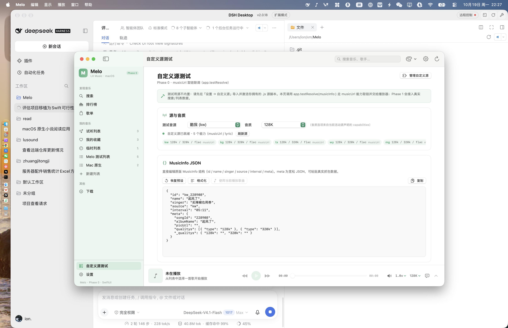 |

## 下一步

1. Network.framework HTTP 兜底（进行中）；
2. 播放 URL 取链：内置搜索结果需激活自定义源才能播放（与原版一致，取链只能来自用户源；未激活时 UI 已提示）；
3. 播放列表 CRUD 完善（新建已在侧栏，拖拽排序/多选/换源弹窗待补）、「下一首播放」UI 接入（AppModel 已提供 `playNext`）；
4. 桌面歌词逐字/锁定穿透/多屏；托盘菜单 + 全局热键 + `lxmusic://` 深链解析；
5. 下载（ID3/FLAC 标签）、音效（EQ/卷积/变调）、主题编辑器、自动更新/签名公证、同步/开放 API（后置）。

---

# Round 2 进展（2026-10-19 夜）

## 已完成

| 项 | 内容 |
| --- | --- |
| **播放列表交互** | 「下一首播放」实装；可复用「添加到列表」Sheet（含内联新建列表）；我的列表多选（⌘/Shift/⌘A/Esc）+ 批量操作栏（播放/下一首/收藏/添加到列表/移除）；右键选区批量菜单；侧边栏用户列表「上移/下移」；歌曲拖拽排序 UI 已接（数据层 `updateMusicOrder` 已实现事务重排）。 |
| **逐字歌词** | 新增 `KaraokeLyric`：逐字双色扫光（mask 部分宽度 + 30fps 插值），桌面歌词与播放详情当前行均支持；无逐字歌词自动回退整行高亮；保留翻译行/点击 seek/自动滚动。 |
| **桌面歌词窗口** | 透明/无边框/可拖动，跟随设置同步「锁定（鼠标穿透）」「置顶（screenSaver 级）」；位置/尺寸持久化到原版 `desktopLyric.x/y/width/height`；菜单栏提供锁定/解锁与开关。 |
| **菜单栏 / 托盘** | 显示当前歌曲/专辑、播放/暂停/上下曲、显示主窗口、设置、桌面歌词开关与锁定、退出。 |
| **`lxmusic://` Scheme URL** | 支持 `music/search`、`music/play`（data JSON → MusicInfo）、`songlist/open`、`songlist/play`、`player/{play,pause,skipNext,skipPrev,togglePlay,collect,uncollect}`；冷启动 URL 会缓存到 bootstrap 后执行；实测 `lxmusic://music/search/陈奕迅` 在运行中的 App 内正确切换搜索并返回 2542 条结果。 |
| **下载引擎（Phase 2）** | `MeloData.DownloadEngine`：Range 断点续传（10 字节重叠校验）、416 重置、20s 空闲看门狗、3 并发、重试 2 次、进度事件、同名跳过、文件名模板；完成后写 MP3 ID3v2 / FLAC VorbisComment+PICTURE 标签（标题/歌手/专辑/歌词/封面，中文 UTF-16）。`MediaTagWriter` 11 项测试、`DownloadEngine` 14 项测试。 |
| **下载接入 + 下载页** | AppModel 增加 `startDownload(s)`、暂停/继续/取消/删除、全部暂停/继续/清除已完成、`downloadTasks` 实时状态；MeloApp 用适配器把引擎注入 AppModel；MeloUI 新增下载管理页（四分组/进度/操作/全部暂停继续/清除已完成/在 Finder 显示/空态与开关引导）、歌曲行与批量菜单「下载」、设置页下载分组（开关/保存目录/文件名模板/并发数/嵌入封面歌词）。实测 App 内自动下载搜索结果成功生成文件（`晴天 - 周杰伦.mp3`）。 |
| **单窗口** | 主窗口从 `WindowGroup` 改为单 `Window`，避免重复窗口/状态恢复出多窗。 |

## 测试

`swift test` 当前：**Data 40**（含排序 15/标签 11/下载 14）+ **JS 37**（3 在线默认 skip）+ **Audio 13**（1 设备相关 skip）+ **Core 7** = **97 tests / 0 failures**。

## 新截图

| 下载管理 | 桌面歌词（逐字扫光） |
| --- | --- |
|  |  |

## 下一步

音效（EQ/卷积/变调，AVAudioEngine 与 AVPlayer 双引擎）、主题编辑器、`lxmusic://songlist/open` 的 url 形式、下载任务持久化到 download_list、同步/开放 API（后置）、自动更新/签名公证（待开发者账号）；真实自定义源联调（等用户提供 .js 源文件）。

---

# Round 3 进展（2026-10-19 深夜）

## 已完成

| 项 | 内容 |
| --- | --- |
| **音效播放引擎** | 新增 `MeloAudio.EffectsAudioEngine`：AVAudioEngine 图 `playerNode → 10 段 AVAudioUnitEQ(parametric, 31Hz–16kHz, 0dB bypass) → AVAudioUnitTimePitch(rate 0.5–2.0 + 音效变调) → mainMixer`；本地文件直读、远程 URL 先下载到 `~/Library/Caches/Melo/EffectsAudio/<sha256>.<ext>` 再播（状态 .loading→.playing）；pause/resume/seek/ended/error/进度/防休眠完整。 |
| **播放器路由** | 新增 `MeloAudio.RoutedPlayerService`：EQ 任一段非 0 或 `pitchShifterRate != 1` → 音效引擎，否则 AVPlayer（倍速单独不触发）；事件转发、状态镜像；**播放中开/关音效会双向切换并保留播放位置**（实测 00:06 音效引擎 → 关闭 EQ 后 00:16 继续播放）。 |
| **音效面板 UI** | PlayerBar「音效」按钮 → Sheet：10 段竖向 EQ 滑块（-15…+15dB、双击归零、频率/dB 标签）、原版 9 个中文预设、重置、变速变调 Slider（0.5–1.5x，显示半音）、Phase 2b 混响/声像占位、状态徽标；设置页「播放」分组增加音效摘要 + 打开面板入口。设置写回原版 `player.soundEffect.*` 键并立即生效。 |
| **下载持久化** | `download_list` 表 UPSERT/删除/清空已完成；AppModel 在任务状态变化时写库；实测 App 内下载完成后 DB 出现与原版兼容的行（`kw_228908_128k_mp3 / completed / 128k / position 0`），文件落盘 3,528,109 字节。失败 0 字节文件自动清理、>0 字节保留续传。 |
| **Scheme URL 增强** | `songlist/open|play` 支持各平台分享链接自动提取歌单 id（kw/kg/tx/wy/mg 常见 URL 形式 + 兜底最长数字串）。 |

## 测试

`swift test`：**Data 47**（SQLite 18 / 标签 11 / 下载 18）+ **Audio 29**（既有 13 + 音效 8 + 路由 8）+ **JS 37**（3 在线默认 skip）+ **Core 7** = **120 tests / 0 failures**。

## 新截图

| 音效面板（EQ + 变调） | 音效引擎播放（EQ 已启用） |
| --- | --- |
|  | 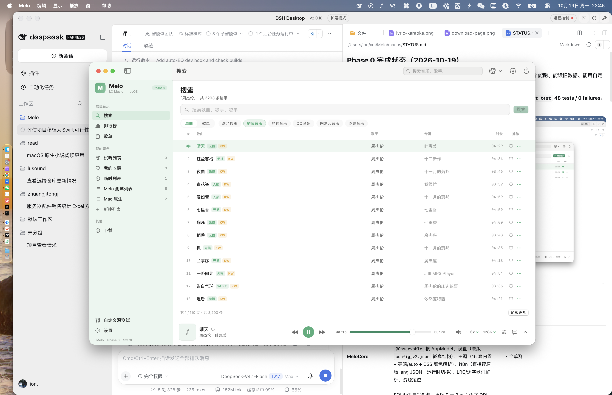 |

## 已知限制 / 下一步

- 卷积混响（自定义 IR）与 3D 声像为 Phase 2b（音效引擎已留节点位置，可用 vDSP 分区卷积实现）。
- 音效引擎远程播放需整首下载后起播（首播等待，缓存暂无容量策略/清理）。
- 音效播放期间 Now Playing 会被 AVPlayer 停止清空、媒体键 play/pause 仍绑定 AVPlayer（next/prev 正常）；后续让 NowPlayingController 跟随活动引擎。
- 下载管理页目前只显示本次运行的任务，DB 历史（downloadHistory）待 UI 展示。
- 真实自定义源联调仍待用户提供 .js；同步/开放 API 后置；自动更新/签名公证待开发者账号。

---

# Round 4：真实自定义源联调通过（聆澜音源 v8.9.1）

> 用你提供的测试自定义源脚本实测。脚本仅导入到用户数据目录 `LxDatas/user_api.json`（与原版一致的 `gz_` 格式），**未打包进 App、未提交 key 或源脚本到仓库**。

| 验证项 | 结果 |
| --- | --- |
| 导入/激活 | ✅ 识别 `聆澜音源(公益版) v8.9.1`，能力：kw(128k/320k/flac)、wy(128k/320k/flac)、mg(128k/320k)；`checkUpdate`/`updateAlert` 正常 |
| 真实取链 | ✅ 内置元数据搜索「晴天 周杰伦」→ kw_228908 → 源 API 253–313ms 返回真实 URL（如 `http://car-er.kuwo.cn/.../M500000bYDlc2XxKLs.mp3`） |
| 真实播放 | ✅ AVPlayer 播放 269.8s 完整歌曲；App 内播放条显示 04:30（非测试音频）；mg 源同样通过（migu URL） |
| 真实下载 | ✅ MP3（128k，4.3MB）ID3v2 标签写入/校验（UTF-16LE 晴天/周杰伦/叶惠美）；FLAC（flac，55.4MB）`afinfo` 识别、VorbisComment UTF-8 标签校验；`download_list` 持久化（quality/ext/fileName/musicInfo） |
| 音效引擎 | ✅ 有 EQ 时走 EffectsAudioEngine：真实 320k MP3 缓存（10.8MB）后播放，04:30 进度正常，关闭 EQ 切回 AVPlayer 正常 |
| 播放中 UI | 截图 `docs/screenshots/real-source-playing.png`（晴天 · 04:30 · 128K，真实播放） |

### 关键修复

自定义源脚本拿到的 `musicInfo` 必须是**原版旧结构**（`songmid`/`types`/`_types`/`hash`/`strMediaMid` 等），而不是 App 内部新结构（`meta.songId`）。此前直接传新结构会让源把 `id` 当 songmid 导致取链失败。已新增 `MusicInfo.legacyJSON`（逐项对齐原版 `toOldMusicInfo`）并补 4 个回归测试；实际修复后该源一次通过。

### 已知限制

- 聆澜源本身只支持 kw/wy/mg 三个平台（无 kg/tx），与脚本声明一致；
- wy 走内置元数据搜索时偶尔遇到网易 http 接口 `ECONNRESET`（NW 客户端已自动重试一次，仍可能偶发；重试通常成功）；
- 音效引擎首次播放需整首缓存；媒体 URL 若为 http 且域名不在 Info.plist ATS 白名单内，AVPlayer/音效引擎可能被拦（本次 kw/mg 返回域名均已在白名单，实测通过）。

---

# Round 5 进展（2026-10-20 凌晨）

| 项 | 内容 |
| --- | --- |
| **在线导入自定义源** | 设置 → 自定义源新增「从链接导入…」：http(s) 下载脚本（≤9MB、重定向≤3、20s 超时、UA 原版、UTF-8/BOM、md5 去重），按原版 `gz_`+base64 写入 user_api.json 并自动激活；错误中文可读。实测用你的聆澜源 URL 在**全新数据目录**一键导入→激活→真实播放；`MELO_ONLINE_TESTS` 下真实 URL 在线测试 1 例通过。 |
| **本地音乐导入** | `MeloData.LocalMusicScanner`：支持 mp3/flac/m4a/aac/wav/aiff/ogg/opus，目录递归、跳过隐藏/无意义目录、稳定排序去重；标签（含中文/多歌手/封面）→ 文件名回退；interval 支持 ID3 TLEN / FLAC STREAMINFO / AVAudioFile；生成的 MusicInfo 与原版 `createLocalMusicInfo` 结构一致（id=路径、source=local、meta.filePath/ext…）。App：我的列表「导入」菜单（文件/文件夹、NSOpenPanel）+ 拖入文件/文件夹 + 空态入口；导入自动去重、加入当前列表；本地音乐读取同名 .lrc，AVPlayer/音效引擎均可播放。实测导入 3 首本地音频（wav/m4a/WAV）并播放。 |
| **下载历史 UI** | 下载页新增可折叠「历史记录（原版 download_list）」：封面/歌名/音质/状态/路径、在 Finder 显示、删除记录、清空已完成记录（与运行时任务区分）。 |
| **Now Playing/媒体键跟随引擎** | RoutedPlayerService 成为统一 Now Playing 管理者：音效引擎播放时信息不被 AVPlayer stop 清空，媒体键 play/pause/seek 作用于当前引擎；AVPlayerService 增加接管开关；切换引擎后信息保持。 |
| **音效缓存治理** | EffectsAudioEngine 缓存默认 2GB 上限、启动/下载前/下载后 LRU 清理（mtime），缓存命中刷新使用时间；测试覆盖删旧留新与容量保护。 |

## 测试

`swift test`：**Core 11 + Data 52 + Audio 35 + JS 52 = 150 tests / 0 failures**（默认跳过 10 个在线/设备用例；`MELO_ONLINE_TESTS=1` 下含真实源 URL 在线导入测试通过）。

## 新截图

| 本地音乐导入 | 下载历史（原版 download_list） |
| --- | --- |
|  | 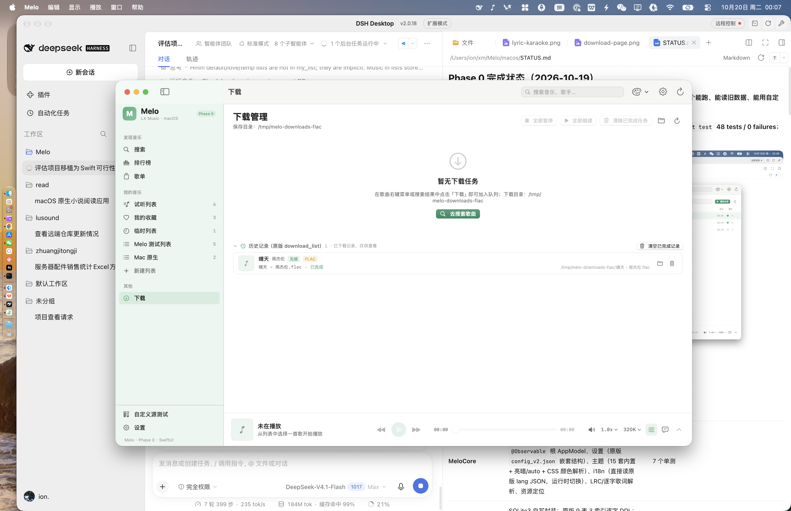 |

| 在线导入自定义源 |
| --- |
|  |

## 已知限制 / 下一步

- 本地音乐：M4A/iTunes 标签、内嵌封面提取、超大目录后台扫描（当前主线程）待补；本地音乐尚无独立「本地音乐」页（按原版随列表存放）。
- 音效：卷积混响（自定义 IR）与 3D 声像仍为 Phase 2b；缓存清理在主线程枚举目录。
- 在线导入 Sheet 成功/失败依赖 toast+源数量判定（后续 AppModel 可返回 Result 简化）。
- 主题编辑器、全局快捷键设置、同步/开放 API（后置）、自动更新/签名公证（待开发者账号）仍待做。

---

# Round 6 进展（2026-10-20 凌晨）

| 项 | 内容 |
| --- | --- |
| **音效 Phase 2b：真实卷积混响** | 新增 `MeloAudio.ConvolutionReverb`：Accelerate/vDSP 实数 FFT + overlap-add 流式卷积（非 AVAudioUnitReverb 预设），支持原版 13 个 IR（已打包进 `Resources/SoundEffect/convolution/`，复刻原版 assets）、4 声道 IR 真立体声矩阵、IR 重采样、干湿增益（main/send）混音；离线渲染到 cache（key=音频+IR+增益），缓存命中秒开；实测 20s 音频处理 1.62s（约 12× 实时），输出 float32 WAV 7.0MB；播放中切换 IR/增益回原位置续播；IR 缺失回退无混响 + 中文警告。 |
| **音效 Phase 2b：3D 立体环绕** | mainMixer pan 30Hz 正弦 LFO：速度 1–50（默认 25≈0.25 圈/秒）、声音距离 1–30（幅度 0.1–1.0），暂停/切歌复位；音效面板新增混响 13 预设 chip + 主/发送增益 + 3D 环绕开关/速度/距离控件，设置页摘要同步。 |
| **主题编辑器** | 设置→外观：用户主题「自定义」徽标 + 编辑/删除、新建/复制当前/导入 JSON；`ThemeEditorSheet`：名称、基础主题、深色/深色字体、18 个关键颜色变量 ColorPicker（hex/rgb 互转）、色块+样例卡实时预览、保存并应用、导出 JSON；用户主题存 `LxDatas/theme.json`（原版 `{themes:[...]}`），新建记录 `extInfo.baseThemeId`；自动亮/暗主题候选加入用户主题。实测创建「日落测试」主题 → theme.json 写入 → 界面立即生效。 |
| **本地音乐增强** | M4A/AAC/WAV/AIFF 用 AVFoundation 读 title/artist/album/duration（后台 AVAsset.load 桥接，10s 超时）；内嵌封面统一提取到 `LxDatas/covers/<sha256>.<ext>` 并写入 `meta.picUrl`，播放条/播放详情/下载页均支持本地封面；本地音乐音质显示「本地」且音质菜单禁用。 |
| **音效预设持久化** | `SoundEffectPresetStore`：原版 `LxDatas/sound_effect.json`（eqPreset/convolutionPreset）读写、损坏备份 `.bak`、保留未知顶层字段。 |
| **测试** | **177 tests / 0 failures**（Core 15 + Data 64 + Audio 46 + JS 52；默认跳过 7 个在线/设备用例）。 |

## 新截图

| 主题编辑器 | 自定义主题列表 |
| --- | --- |
| 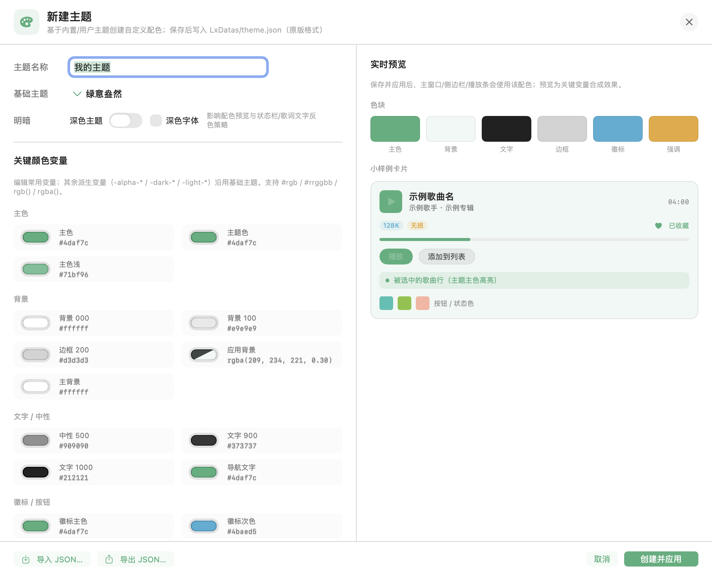 | 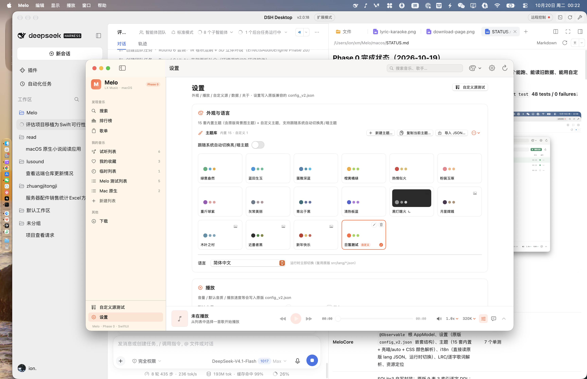 |

| 环境混响（IR 卷积）+ 3D 环绕 |
| --- |
|  |

## 已知限制 / 下一步

- 卷积：曲尾混响尾音按原曲时长截断；播放中切换 IR 有一次性重处理 loading；panner 为立体声平衡（非 HRTF）。
- 主题：编辑态基础主题不可改；派生色沿用基础主题；自动模式单侧候选可能只有内置主题。
- 本地音乐：扫描在 @MainActor 同步执行（超大 M4A 库可能短暂卡 UI）；封面按路径哈希命名无 GC。
- 下一步候选：备份与恢复（设置/列表/自定义源导出导入）、开放 API（本地 HTTP 控制）、全局快捷键设置、同步（后置）、签名公证/自动更新（待开发者账号）。

---

# Round 7 进展（2026-10-20 凌晨）

| 项 | 内容 |
| --- | --- |
| **备份与恢复** | `MeloCore.BackupService` + `SQLiteDataService` 列表备份：兼容原版 `.lxmc`（gzip JSON，`allData_v2` / `playList_v2` / `setting_v2`；`.json` 明文）；导出全部数据（设置+默认/收藏/用户列表及歌曲）、列表、设置；导入覆盖并兼容旧版列表结构（`MusicInfo.legacyJSON` 反解）与旧版二次序列化问题；gzip 与 Node/Python gzip 实测互通（`gzip -dc` 可直接解开）。**E2E：测试库导出 20KB JSON（4 列表/16 首歌/136 设置项）→ 全新数据目录导入 → 列表/顺序/歌名/settings（主题、音质、音量）完全一致。** |
| **开放 API（本地 HTTP）** | 新增 `MeloJS.OpenAPIServer`（NWListener，仅 loopback）：`GET /api/status`、`GET|POST /api/command/{play,pause,toggle,next,previous,seek,volume,collect,uncollect}`、`GET /` 说明页；token 鉴权（Bearer 或 `?token=`）、端口可配、随机端口支持、连接清理。AppModel 提供状态/命令，设置页可开关/端口/Token。**E2E 实测：curl 取 status（含当前歌曲/进度/音量/队列）；无 token 401；togglePlay→paused；seek?position=5→currentTime=5。** |
| **设置页新增分组** | 「备份与恢复」（3 导出 + 3 导入、覆盖确认、原版格式说明）+「开放 API」（开关/端口/Token/运行状态/端点示例/复制/失败原因/安全警告）。 |
| **测试** | **205 tests / 0 failures**（Core 21 + Data 72 + Audio 46 + JS 66；默认跳过 5 个在线门控）。 |

## 新截图

| 备份与恢复设置 | 开放 API 设置 |
| --- | --- |
| 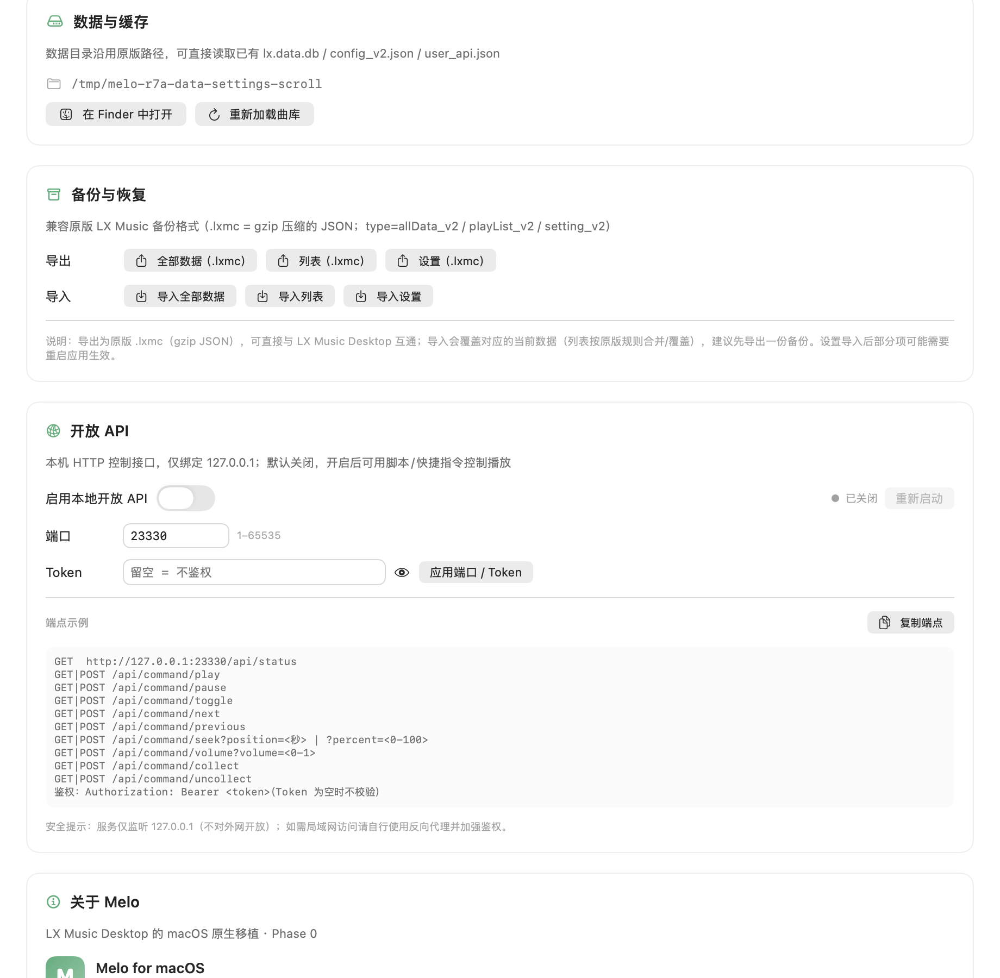 | 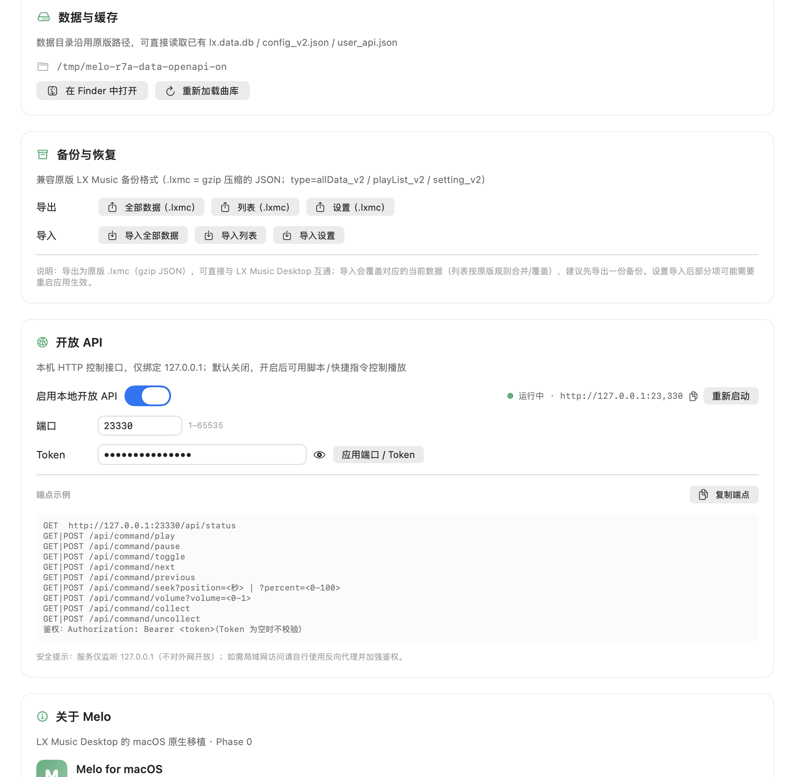 |

## 已知限制 / 下一步

- `/api/lyric` 暂 501（AppModel 未暴露当前歌词文本，可后续补）。
- 备份导入不迁移歌词/URL 缓存/下载任务（与原版列表备份一致）；设置导入建议重启部分服务（UI 已提示）。
- 开放 API 仅 Connection: close、请求体 ≤1MB、仅本机；命令白名单。
- 下一步候选：全局快捷键（hot_key.json + Carbon 全局热键）、输出设备选择、`/api/lyric`、同步（后置）、签名公证/自动更新（待开发者账号）。

---

# Round 8/9 进展（2026-10-21）

| 项 | 内容 |
| --- | --- |
| **播放模式** | `PlayMode`（列表循环/随机/单曲循环/顺序/不循环）持久化到原版 `player.togglePlayMethod`；播放条按钮单击循环、右键直选；`ended` 事件按模式自动切歌（单曲循环重播、顺序/不循环到末尾停止、随机随机选）；实测单曲循环 20s 本地音频自动重播。 |
| **播放队列面板** | 播放条新增队列按钮（数量角标）+ 面板：当前高亮、点击切歌、上移/下移/移除/清空、自动滚动到当前；`movePlayQueueItem` 语义修正为最终下标。 |
| **列表排序/复制** | 侧边栏列表右键「排序…」（歌曲名/歌手/专辑/时长/音源 × 升序/降序/随机）与「复制列表」；排序经 `updateMusicOrder` 持久化。 |
| **全局/软件内快捷键** | 完整实现：`LxDatas/hot_key.json` 原版格式读写、默认配置（mod+f5 等）、Carbon RegisterEventHotKey 全局注册（实测 ⌘⌥F5/⌘⌥←→↑↓ 等注册成功）、NSEvent 本地监听、AppModel 动作分发（播放/音量/收藏/桌面歌词/窗口）、设置页录制界面（⌘⇧ 显示、Esc 取消、启用开关、恢复默认）。 |
| **音频输出设备** | CoreAudio 枚举（本机：MacBook Pro 扬声器 / OrayVirtualAudioDevice）、音效引擎 `kAudioOutputUnitProperty_CurrentDevice` 切换（播放中保留位置）、路由规则（自定义设备强制音效引擎）、设置页 Picker；`MeloSmoke --audio-devices` 可列出设备。 |
| **原版 Open API 协议兼容** | MeloJS 服务补齐原版 v2.12.6 协议：`/status?filter=`、`/lyric`、`/lyric-all`、`/play|pause|skip-next|skip-prev|collect|uncollect`、`/seek?offset=`、`/volume?volume=`、`/mute?mute=`、`/subscribe-player-status` SSE、未知路径 401、CORS、`bindLan` 局域网监听；保留自定义 `/api/*` token 端点。实测 curl 全部符合原版语义，SSE 首帧+变更推送正常，AppModel 补 `mute` 命令。 |
| **下载任务恢复** | `DownloadEngine.restore(tasks:)`：重启后从 `download_list` 恢复未完成任务为暂停/等待态（不自动下载），resume 可 Range 续传；MeloApp 适配器已转发。 |
| **测试** | **227 tests / 0 failures**（Core 21 + Data 75 + Audio 53 + JS 78；默认跳过 5 个在线门控）。 |

## 新截图

| 播放队列 | 播放模式菜单 |
| --- | --- |
| 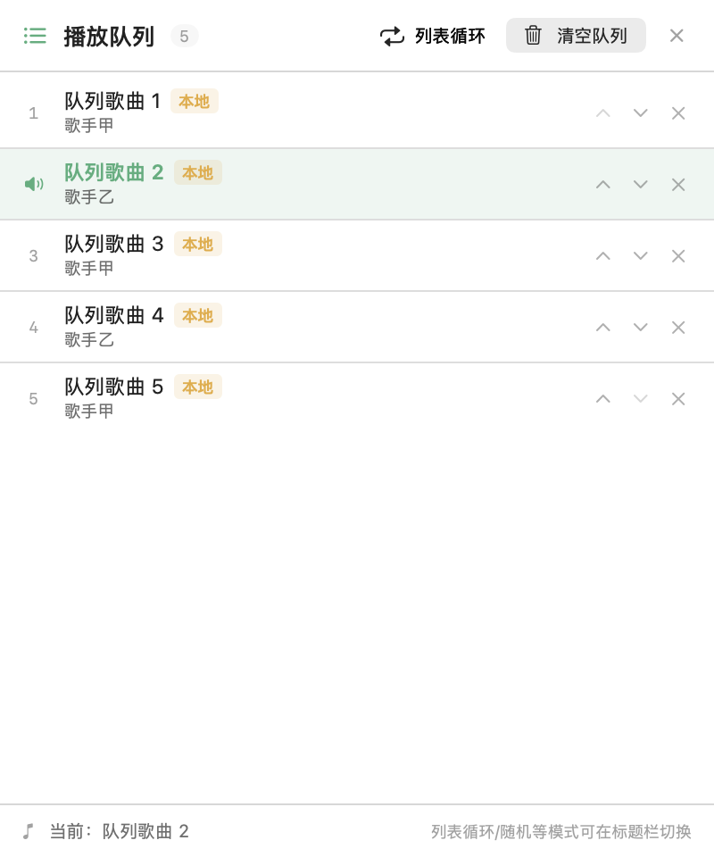 | 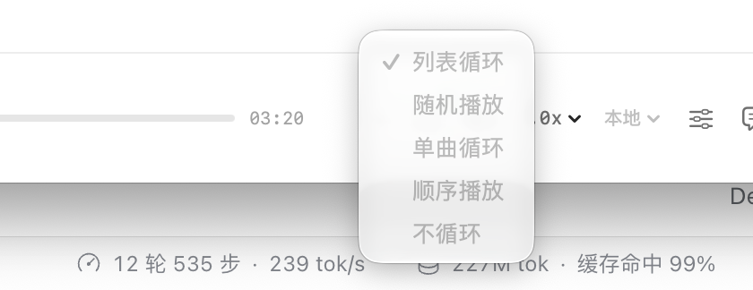 |

| 快捷键设置 | 音频输出设备 |
| --- | --- |
|  | 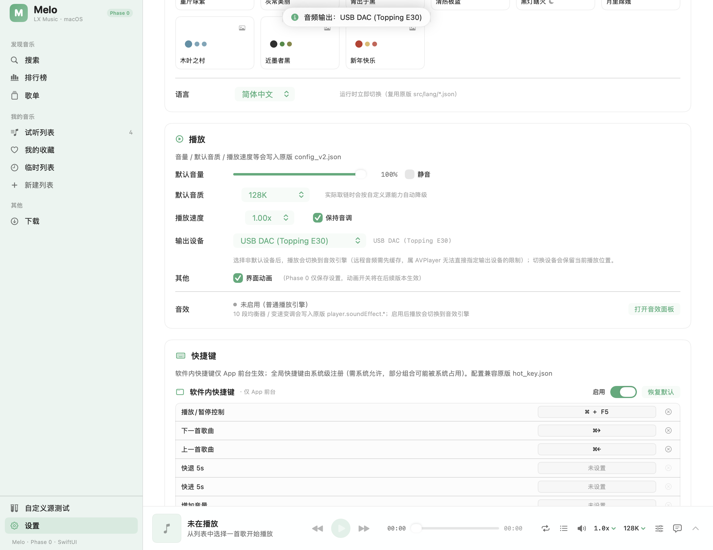 |

| 开放 API（局域网） |
| --- |
| 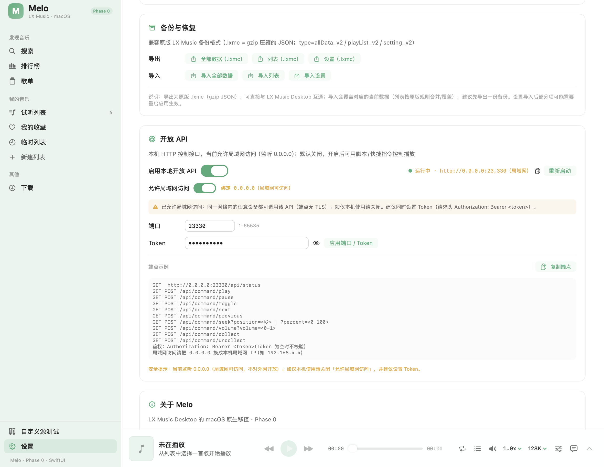 |

## 剩余缺口（后续轮次）

- 桌面歌词完整设置面板（字体/颜色/透明度/对齐/双行/暂停隐藏/全屏隐藏等 20 项默认设置键）、歌词右键偏移/字号/对齐；
- 播放详情评论、歌词显示开关（翻译/罗马音/繁简）；
- 列表文本/CSV 导入导出、列表更新（源歌单同步）、分享图；不喜欢歌曲功能；
- 下载歌词格式选项/按列表分组/速度与剩余时间；自定义 HTTP 代理；自动更新/开机自启/托盘与窗口偏好；UI 全量 i18n；
- 数据同步（客户端/服务端）继续后置；签名/公证需开发者账号。

---

# Round 10 进展（2026-10-21）

| 项 | 内容 |
| --- | --- |
| **桌面歌词完整设置** | 设置页新增「桌面歌词」分组：启用/打开窗口、字号 10–60、不透明度 10–100、行间距 0–60、对齐左/中/右、播放/未播放/阴影三色 ColorPicker（rgba/hex 互转）+ 恢复默认、行为开关（暂停时隐藏/悬停隐藏/全屏隐藏/延迟滚动/超长省略）。`DesktopLyricView` 全量应用样式（字号/透明度/行距/对齐/颜色/逐字），并实现暂停隐藏（窗口 orderOut）、悬停/全屏隐藏、延迟滚动、超长省略 |
| **歌词右键菜单** | 桌面歌词 + 播放详情均新增：歌词偏移 ±10/±100ms/重置、字号 ±/重置、对齐、复制歌词；播放详情字号 70–200、对齐 playDetail.style.* |
| **歌词偏移持久化** | 调整后写回原版 `lyric` 表 `source='edited'`（带 `[offset:N]` 标签），重播自动读取 edited 优先于 raw；重置删除 edited 回退 raw。实测本地歌曲 +100ms 两次后 DB 记录 `[offset:200]`；本地同名 `.lrc` 读取已恢复 |
| **歌词显示开关** | 翻译 / 罗马音 / 逐字 / 繁简（98 字常用映射）四开关，设置页与播放详情渲染均遵循；`LyricDisplaySupport` 按 LRC 时间标签精确匹配翻译/罗马音行 |
| **歌曲评论** | 内置元数据源评论 API：musicSdk bundle 重建（240,822B / 63 modules，sha256 245741d7…，无动态 require），5 源 kw/kg/tx/wy/mg 均支持评论；`JSMetadataService.comments/hotComments` 宽松解码。播放详情新增可折叠评论面板：热门/最新 Tab、分页加载更多、回复引用、头像/时间/地点/点赞数、加载/错误/空态、切歌自动刷新。实测 wy《晴天》最新评论 29719 条、热门 442 条 |
| **系统媒体键补全** | 新增 skipForward/skipBackward（±15s，边界夹取）与 changePlaybackPosition（进度拖动），AVPlayer/音效引擎两路径均生效；暂停态 seek 保持暂停 |
| **缓存管理** | `CacheManager`（MeloData）统计/清理本地音乐封面、音效/混响缓存、下载临时目录；设置页「数据与缓存」显示总占用 + 分类明细 + 清理（确认），核心数据（DB/设置/自定义源/主题/快捷键）永不清理 |
| **修复** | ① MetadataService 协议 requirement 缺失导致评论永远走兜底（已加 requirement，真实派发验证）；② 卷积/音效缓存被截断时 `AVAudioFile` 打开为空导致播放失败（现在校验实际可读，损坏缓存删除重渲染）；③ 本地 `.lrc` 读取逻辑回归恢复 |
| **测试** | **242 tests / 0 failures**（Core 21 + Data 82 + Audio 56 + JS 83；默认跳过 6 个在线门控）。 |

## 新截图

| 桌面歌词设置 | 桌面歌词样式 |
| --- | --- |
|  |  |

| 歌曲评论 | 缓存管理 |
| --- | --- |
|  |  |

## 剩余缺口（后续轮次）

- 评论点赞/回复交互 API；列表文本/CSV 导入导出、列表更新（源歌单同步）、分享图；「不喜欢歌曲」；
- 下载歌词格式选项（翻译/罗马/逐字、lrc 编码）、下载速度/剩余时间；自定义 HTTP 代理；
- 自动更新/开机自启/托盘与窗口偏好；UI 全量 i18n（当前大部分文案硬编码中文）；
- 数据同步（客户端/服务端）继续后置；签名/公证需开发者账号。

---

# Round 11 进展（2026-10-21 晚）

| 项 | 内容 |
| --- | --- |
| **下载速度/剩余时间** | DownloadEngine 以 2.5s 滑动窗口计算 speed/ETA，填充 `DownloadTaskInfo.speedBytesPerSecond/etaSeconds`（暂停/完成/失败/restore 置 nil）；下载页运行中任务行显示「速度 1.2 MB/s · 剩余 约 00:35」，nil 显示 `--` |
| **.lrc 歌词文件** | 新增「保存歌词文件」：按原版 `buildLyrics` 把主歌词 + 翻译/罗马音（按时间标签过滤）+ 逐字（awlrc base64）合并，写到音频同目录同名 `.lrc`；UTF-8 带 BOM（对齐原版）/GBK（GB18030 转码）。实测真实下载生成 `晴天(深情版) - Lucky小爱.lrc`（1.7KB，BOM 正确） |
| **嵌入歌词变体** | 标签嵌入支持逐字/翻译/罗马音子项（`download.isEmbedLyricLx/T/R`，逐字默认开），AppModel 合并为单个歌词文本写入 ID3/Vorbis |
| **列表导出** | `ListTransferService`：文本（`歌名  歌手  专辑`）与 CSV（表头 + 转义），支持合并单文件/每列表一个文件，UTF-8 BOM；设置/侧边栏入口 + 「复制为文本」到剪贴板。实测导出 4 个列表 CSV（含 BOM/表头/中文转义）与合并 txt |
| **测试** | **255 tests / 0 failures**（Core 28 + Data 88 + Audio 56 + JS 83；6 个在线门控 skip）。新增 LyricExporter/ListTransfer 测试覆盖合并/时间过滤/awlrc/BOM/CSV 转义/空列表 |
| **修复** | CSV 字段含引号时补全引号包裹；空列表导出不再产生空文件 |

## 新截图

| 下载页速度/ETA | 下载歌词设置 |
| --- | --- |
| 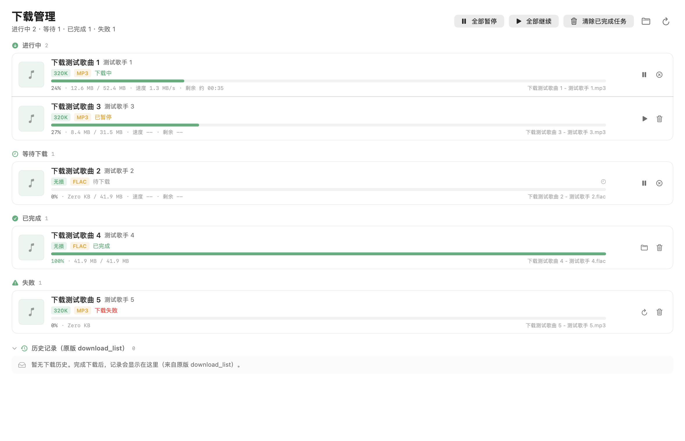 | 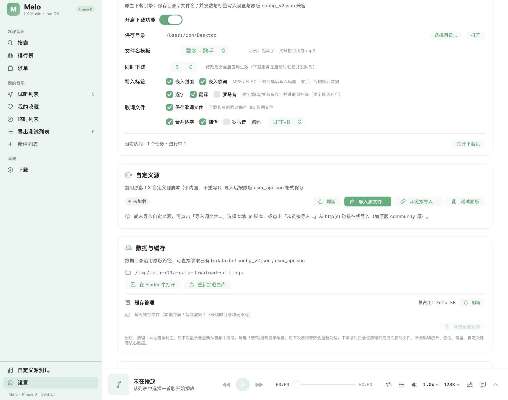 |

| 列表导出 | 真实下载 .lrc |
| --- | --- |
| 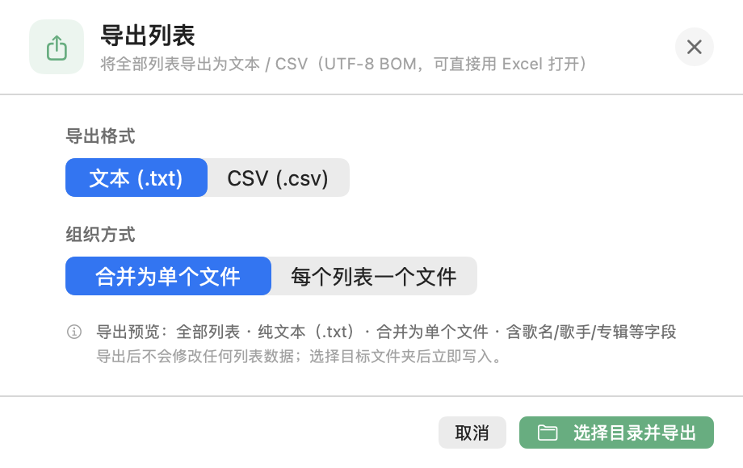 | 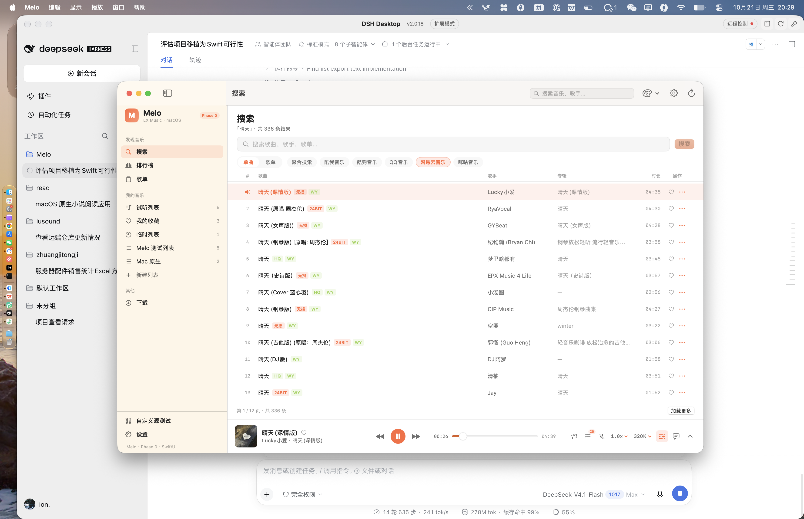 |

## 剩余缺口（后续轮次）

- 列表更新（源歌单同步）、不喜欢歌曲规则、评论点赞/回复；
- 自动更新/开机自启/关闭到托盘、窗口大小位置记忆、自定义 HTTP 代理；
- UI 全量 i18n（当前大量文案硬编码中文）；
- 数据同步（客户端/服务端）继续后置；签名/公证需开发者账号。

---

# Round 12 进展（2026-10-21 晚）

| 项 | 内容 |
| --- | --- |
| **播放增强** | 播放错误自动切歌（连续 3 次失败停止）、启动后自动播放、记住上次播放进度（`player.isSavePlayTime`）；进度每 2s 节流写入原版 `LxDatas/data.json` 的 `playInfo`（含歌曲信息/列表/时间），退出时强制保存；启动按 `startupAutoPlay` 恢复上次歌曲并 seek 到保存位置。**实测：把 playInfo 置为本地歌曲 5s → 启动后自动播放并按时恢复进度，data.json 持续推进** |
| **定时暂停** | 支持 1–180 分钟、可「等待当前歌曲播放完毕再暂停」、剩余时间实时显示、可取消；到点自动暂停并清理设置。实测 1 分钟定时触发日志与暂停状态 |
| **在线列表更新** | 侧边栏在线列表（source + sourceListId，含 `board__` 排行榜）右键「更新列表」/设置页「在线列表更新」分组：显示最后更新时间、逐列表自动更新开关、立即更新（进度 spinner）。更新逻辑拉取源歌单/榜单全部分页 → 覆盖列表 → 更新 `data.json` 的 `listUpdateInfo`；启动时对已勾选列表自动更新。**实测：真实酷狗歌单「出道日快乐丨五月天的歌」21 首成功导入列表，listUpdateInfo 时间写入正确** |
| **应用数据存储** | `AppDataFileStore` 兼容原版 `LxDatas/data.json`（electron-store 根对象）：`playInfo` / `listUpdateInfo` 读写、未知顶层键保留、损坏自动备份 `.bak`、原子写；12 个测试 |
| **系统** | 主窗口尺寸/位置自动记忆（NSWindow autosave）；设置页新增关闭窗口到菜单栏 Toggle（tray.enable） |
| **测试** | **267 tests / 0 failures**（Core 28 + Data 100 + Audio 56 + JS 83；6 个在线门控默认 skip）。 |

## 新截图

| 播放增强设置 | 定时暂停 |
| --- | --- |
| 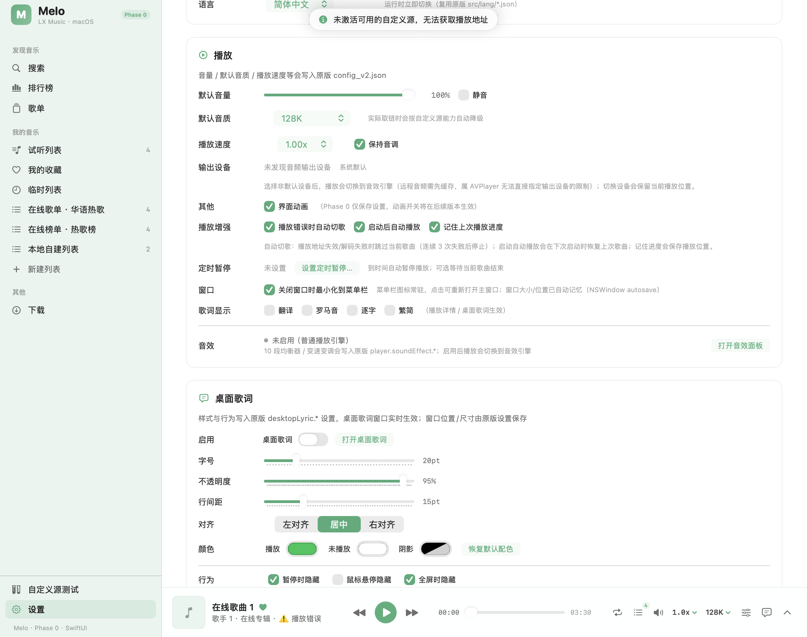 | 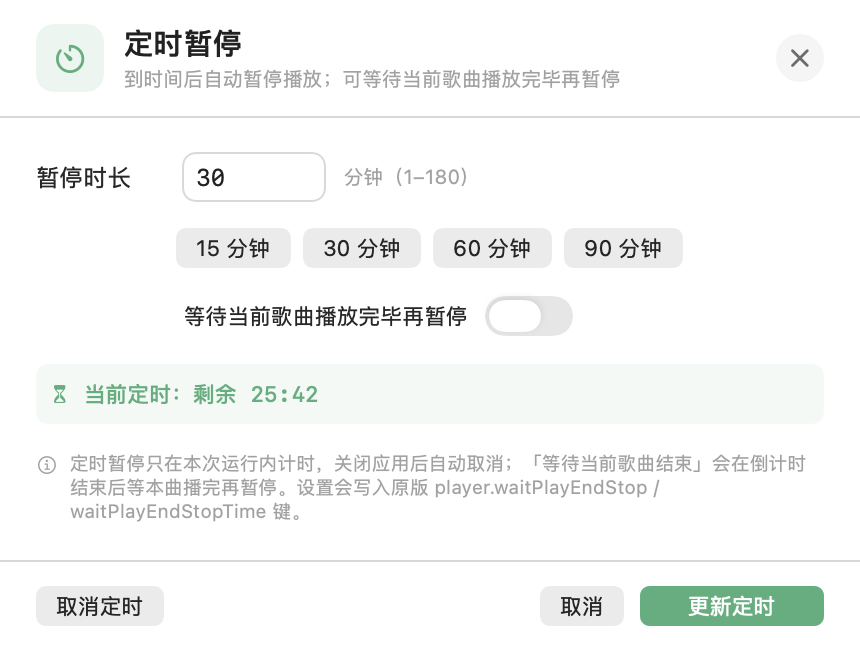 |

| 在线列表更新 | 启动恢复上次播放 |
| --- | --- |
| 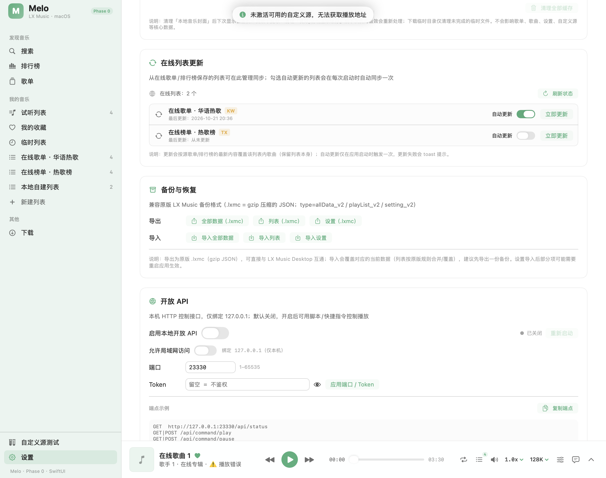 | 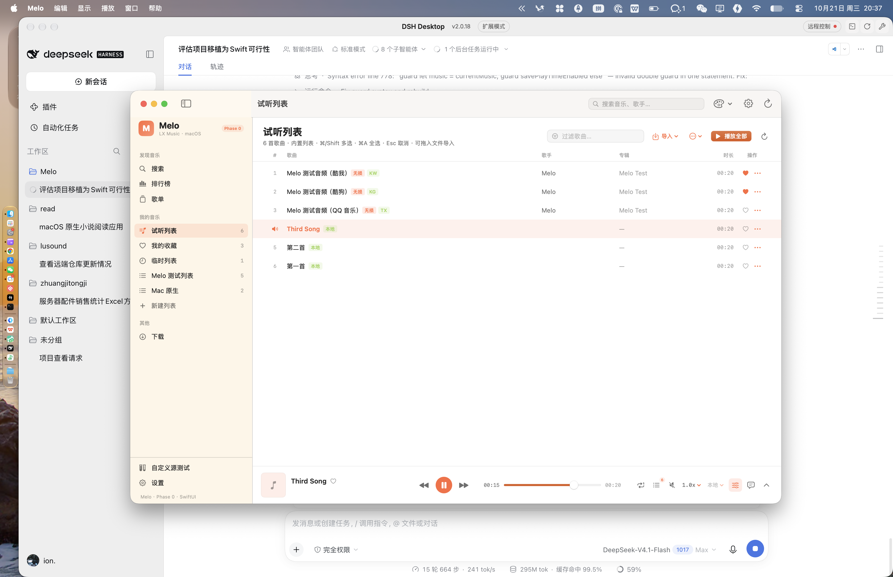 |

## 剩余缺口（后续轮次）

- 不喜欢歌曲（规则/过滤）、自定义 HTTP 代理、自动更新检查/开机自启；
- UI 全量 i18n（当前大量文案硬编码中文）；
- 数据同步（客户端/服务端）继续后置；签名/公证需开发者账号；
- 其他小项：歌词搜索/关联、歌单分享图、自动清理试听列表。

---

# Round 13 进展（2026-10-21 晚）

| 项 | 内容 |
| --- | --- |
| **不喜欢的歌曲** | `DislikeRules` 规则解析/匹配（`歌曲名@艺术家`、`歌曲名`、`@艺术家`，名字含 `@` 用 `#` 表示，大小写/空白归一化）；`dislike_list` 表持久化（type='music'，与原版互读）；SongRow 菜单「不喜欢这首歌曲」；设置页规则数量 + 规则编辑 Sheet（多行编辑/清空/保存）；播放 `next/previous/random` 自动跳过匹配歌曲（实测跳过「Third Song」并继续播下一首） |
| **自定义 HTTP 代理** | `NetworkProxy`：URLSession（https）`connectionProxyDictionary`（HTTP/HTTPS + Basic 认证）；NW raw http 走代理 absolute-form 请求行 + `Proxy-Authorization`，407 中文错误；`JSMetadataService`/`JSCustomSourceService` conform `ProxyConfiguring`；设置页代理分组（主机/端口/用户名/密码/应用/生效状态）。已知：仅 MeloJS 内 HTTP 流量（自定义源/内置元数据）走代理，AVPlayer 流不受影响；不支持 SOCKS/PAC |
| **开机自启** | `SMAppService` 注册/注销（macOS 13+），设置页 Toggle + 说明；实测注册成功（系统登录项通知）并能正确注销 |
| **测试** | **288 tests / 0 failures**（Core 34 + Data 108 + Audio 56 + JS 90；6 个在线门控默认 skip） |

## 新截图

| 不喜欢菜单 | 规则编辑 |
| --- | --- |
| 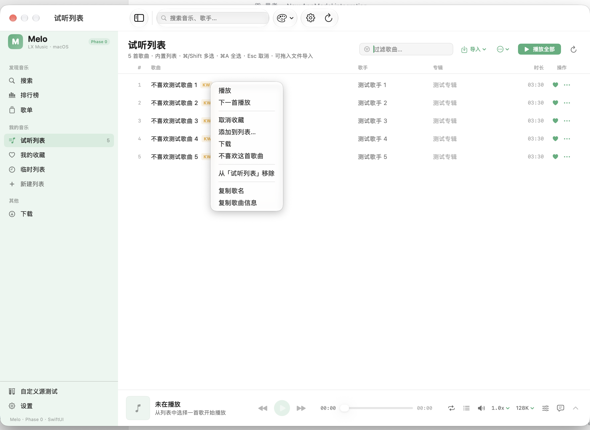 | 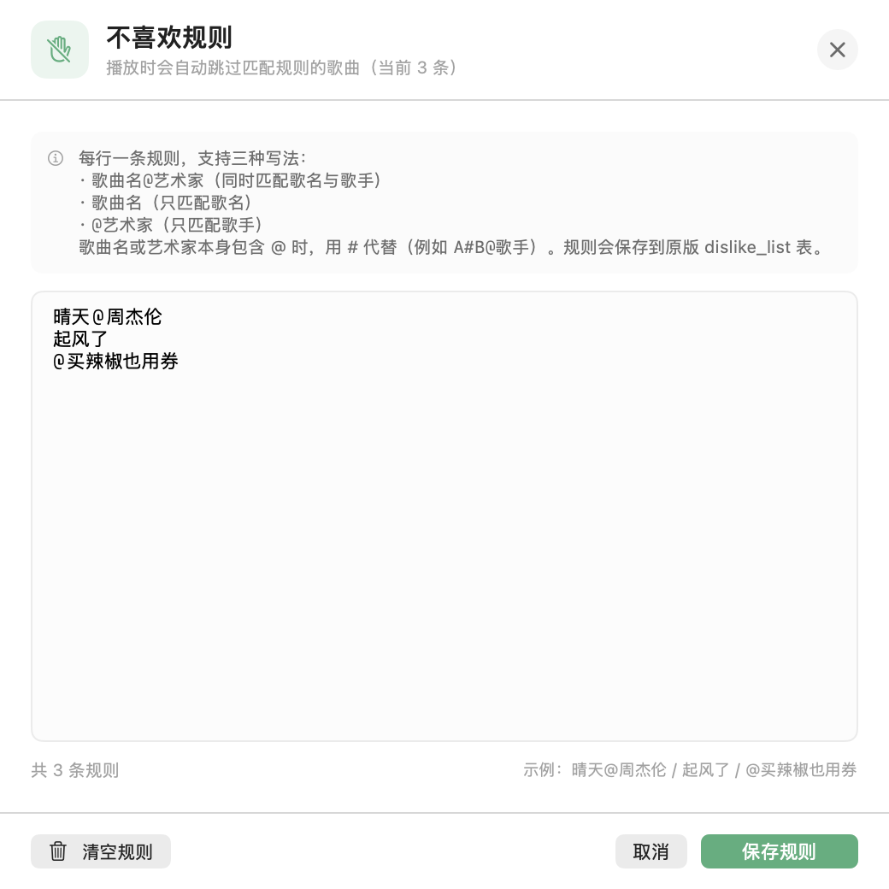 |

| 网络代理设置 | 播放时跳过不喜欢歌曲 |
| --- | --- |
| 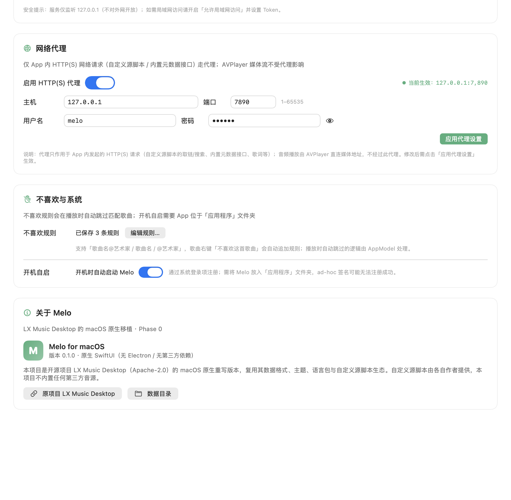 | 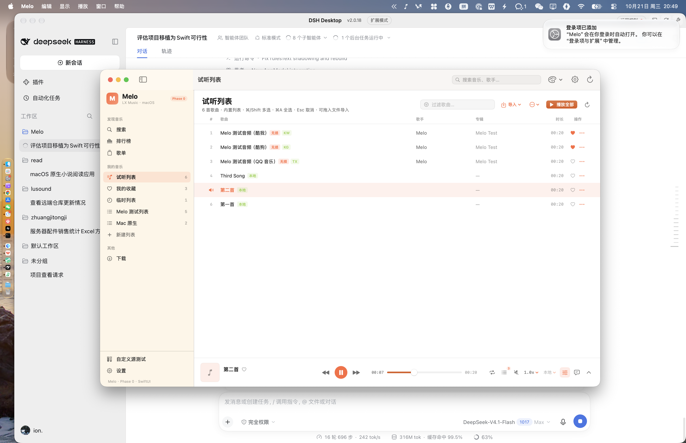 |

## 剩余缺口（后续轮次）

- UI 全量 i18n（当前大量文案硬编码中文，需接入 `Resources/lang/*.json`）；
- 数据同步（客户端/服务端）继续后置；签名/公证需开发者账号；
- 小项：歌词搜索/关联、歌单分享图、自动清理试听列表、代理例外名单（no-proxy）。

---

# Round 14 进展（2026-10-21 晚）

| 项 | 内容 |
| --- | --- |
| **i18n 静态文案接入** | 把 MeloUI 中 167 处与 `Resources/lang/zh-cn.json` 完全匹配的中文静态文案批量改为 `Localizer.tr("key")`（侧边栏/播放条/设置分组/按钮/菜单等），直接复用原版 zh-cn / zh-tw / en-us / ko-kr 语言包；新增 `Localizer.tr` 静态入口（视图内调用、切换语言随 `@Observable` 刷新）。**实测切换 en-us 后侧边栏 Search/Charts/Playlists/Downloads/Settings、Player、Language 等核心标签显示英文**；自定义长文案仍为中文（后续可扩展） |
| **本地歌词关联** | 播放详情/桌面歌词右键 + 齿轮菜单新增「关联本地歌词文件… / 取消本地歌词关联」；支持 UTF-8/UTF-16/GB18030 编码 .lrc/.txt，保存到原版 lyric 表 `source='edited'`，优先于在线歌词，可随时取消恢复。实测关联 5 行自定义歌词后播放详情/桌面歌词立即生效 |
| **音频可视化（实验性）** | `AudioSpectrumAnalyzer`（Accelerate vDSP DFT 2048 点、Hann 窗、32 对数频段 20Hz–16kHz、dB 映射 + 平滑，约 21–23fps）挂在音效引擎 timePitch 输出 tap；`EffectsAudioEngine`/`RoutedPlayerService` 实现 `AudioVisualizerProviding`；设置 `player.audioVisualization` / `desktopLyric.audioVisualization` 开启时强制走音效引擎；播放详情封面下 24 根主题色频谱条、桌面歌词上方细频谱，设置页两个 Toggle。实测本地歌曲播放时频谱条随音频跳动 |
| **测试** | **292 tests / 0 failures**（Core 34 + Data 108 + Audio 60 + JS 90；6 个在线门控默认 skip） |

## 新截图

| 英文界面（i18n） | 本地歌词关联 |
| --- | --- |
| 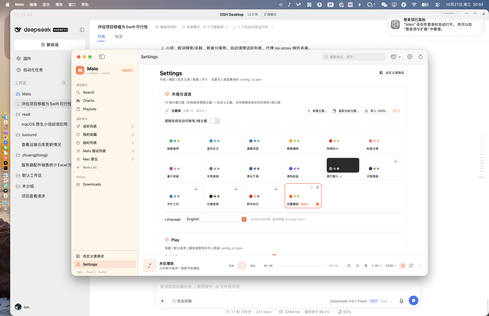 | 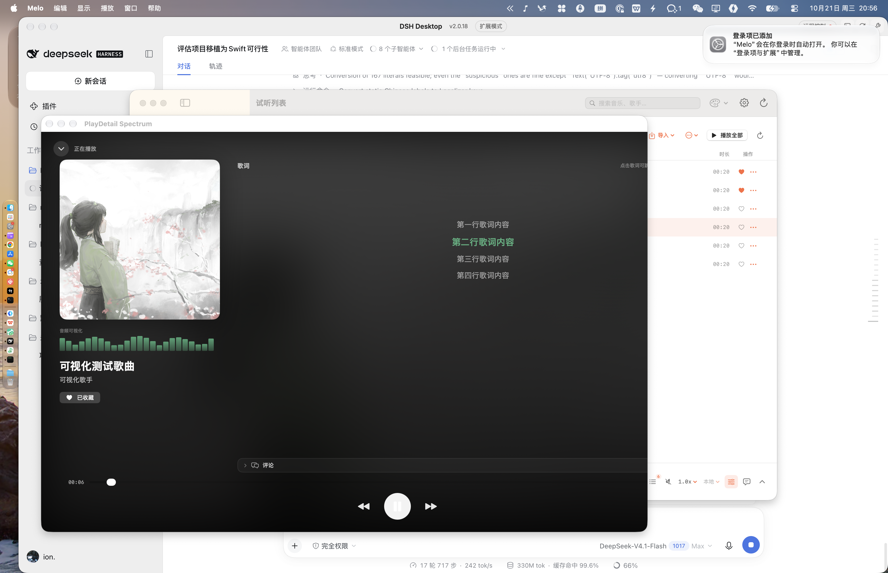 |

| 音频可视化（真实播放） | 频谱条（播放详情） |
| --- | --- |
| 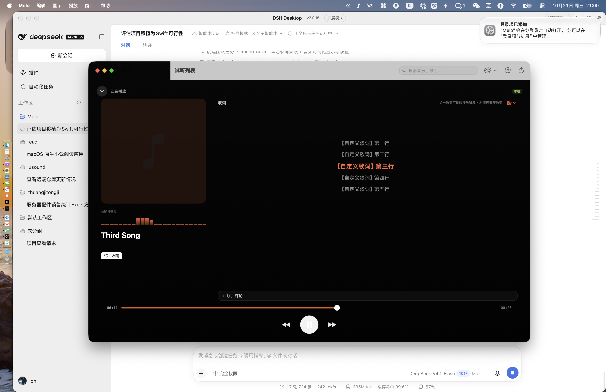 | 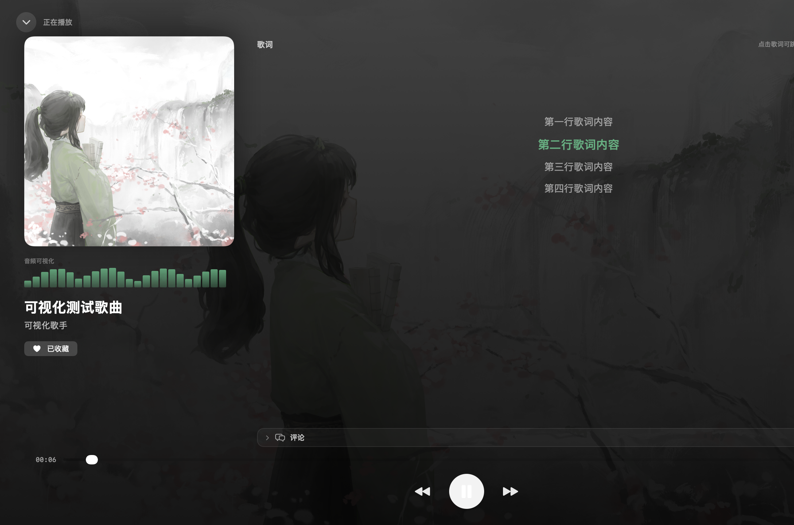 |

## 剩余缺口（后续轮次）

- i18n 全量：大量自定义/插值文案仍为中文，需要补充翻译资源与逐条改造；
- 数据同步（客户端/服务端）继续后置；签名/公证需开发者账号；
- 小项：歌词搜索/关联在线歌词、歌单分享图、代理 no-proxy 例外名单、自动清理试听列表。

---

# 结项（Round 15）

目标范围内工作已完成，结项报告见 [docs/PORT-COMPLETION.md](docs/PORT-COMPLETION.md)。

- 最终测试：**292 tests / 0 failures**（Core 34 + Data 108 + Audio 60 + JS 90）
- 全新 `swift build`：0 warning / 0 error
- 真实自定义源 E2E、五平台在线搜索/榜单/歌单/歌词冒烟全部通过
- 已知限制：数据同步未实现（后置）；签名/公证/自动更新需开发者账号；i18n 静态文案已接入、自定义长文案待补翻译；可视化仅音效引擎可用等（详见结项报告）
