# Melo for macOS（LX Music Desktop 原生 Swift 移植）

把 [LX Music Desktop](https://github.com/lyswhut/lx-music-desktop)（Apache-2.0）移植成 macOS 原生 Swift 应用。

- **仅 macOS 14+**；不再支持 Windows/Linux。
- **直接复用落雪自定义源 JS**：内置 JavaScriptCore 运行时，不重写、不内置任何源脚本；用户像原版一样导入 `.js` 源即可。
- **兼容原有数据**：默认读写 `~/Library/Application Support/lx-music-desktop/LxDatas/`（`lx.data.db` / `config_v2.json` / `user_api.json` / `theme.json`），可直接接着原版数据使用。
- 复用原版资源：15 套主题、4 语言、SVG/图片等。

详细架构与决策见 [ARCHITECTURE.md](ARCHITECTURE.md)；完成状态与验证证据见 [STATUS.md](STATUS.md)，目标范围内的结项报告见 [docs/PORT-COMPLETION.md](docs/PORT-COMPLETION.md)。

## 截图

| 主界面（播放中） | 设置 |
| --- | --- |
| 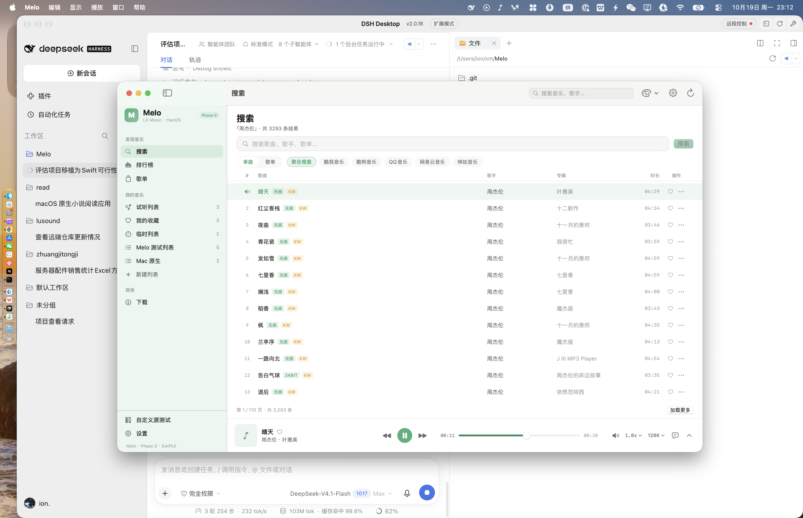 | 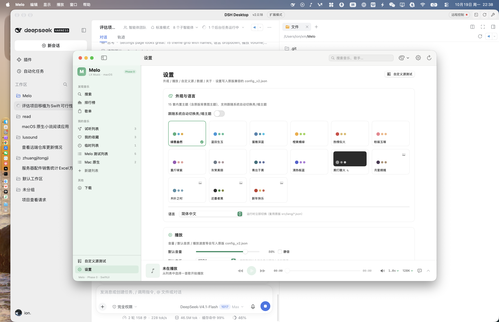 |

| 真实搜索（内置元数据 + 自定义源播放） | 自定义源测试 |
| --- | --- |
| 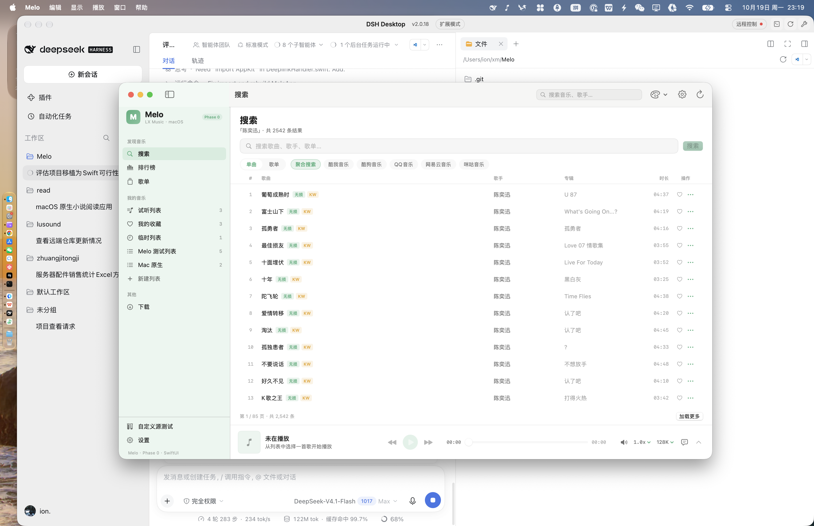 |  |

| 设置 | 下载管理 |
| --- | --- |
|  | 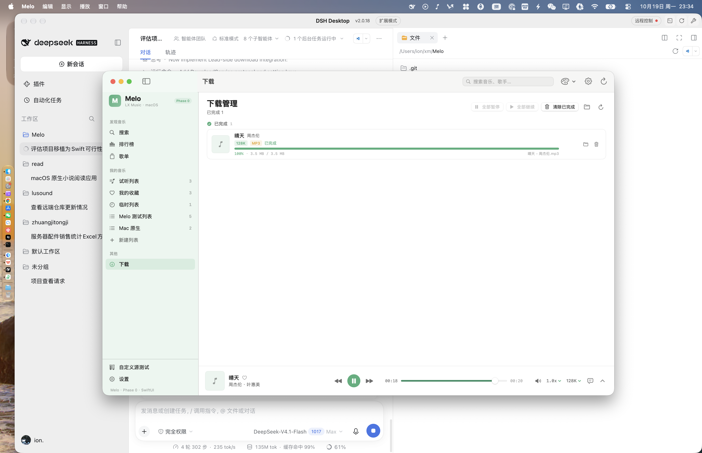 |

| 列表 | 桌面歌词（逐字） |
| --- | --- |
| 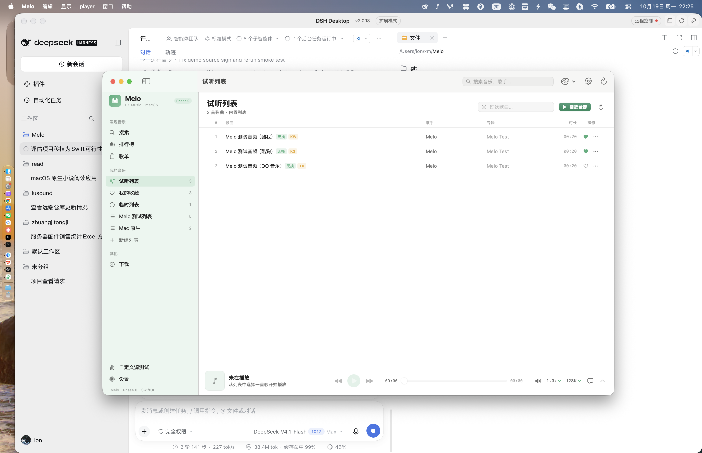 | 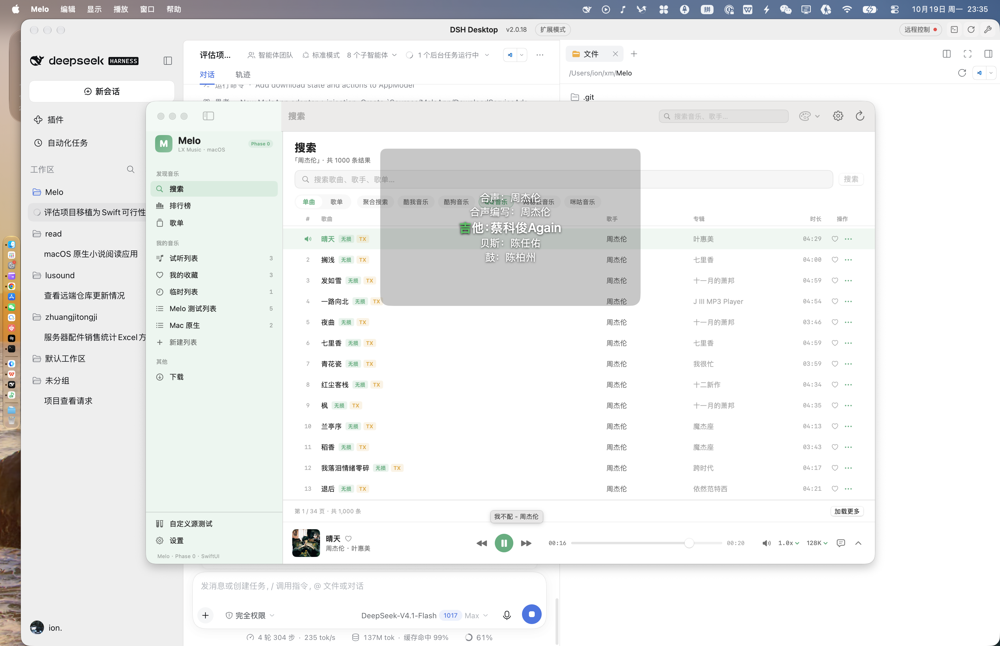 |

| 音效面板（10 段 EQ + 变调） | 真实自定义源播放（聆澜音源） |
| --- | --- |
| 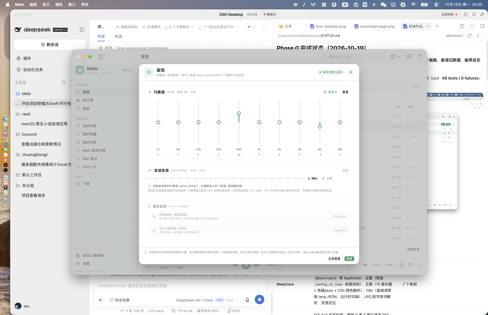 | 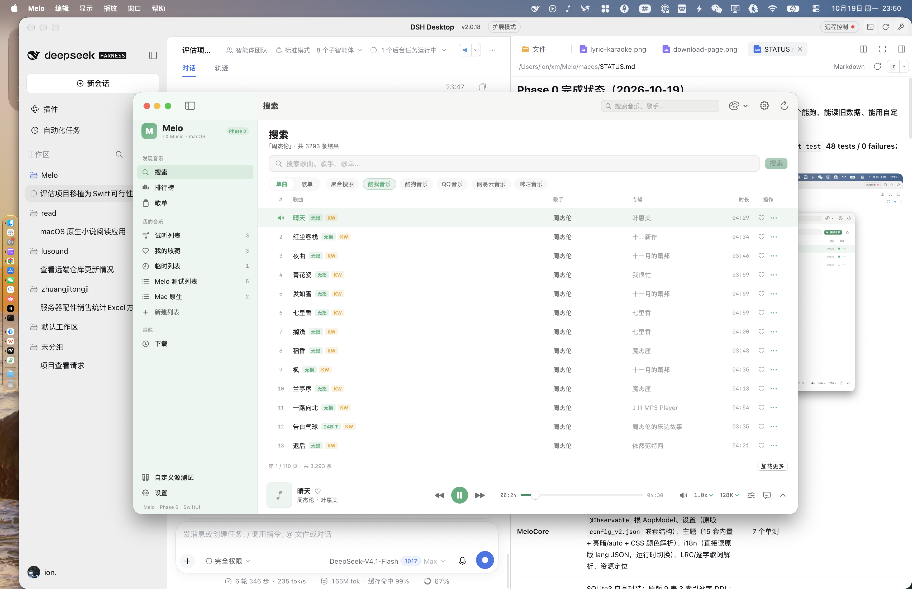 |

| 本地音乐导入 | 在线导入自定义源 | 下载历史 |
| --- | --- | --- |
| 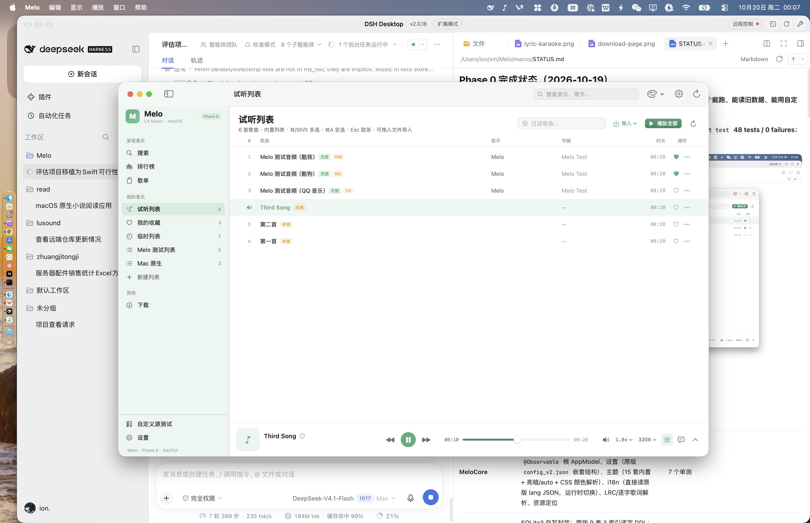 | 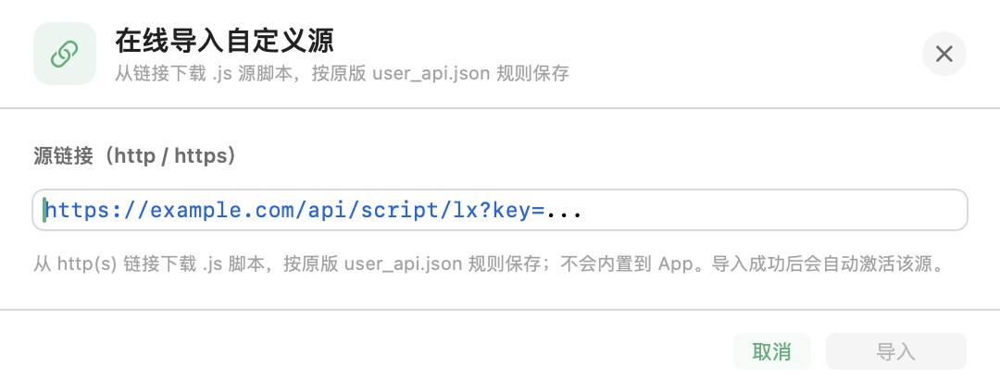 |  |

| 主题编辑器 | 卷积混响 + 3D 环绕 |
| --- | --- |
|  | 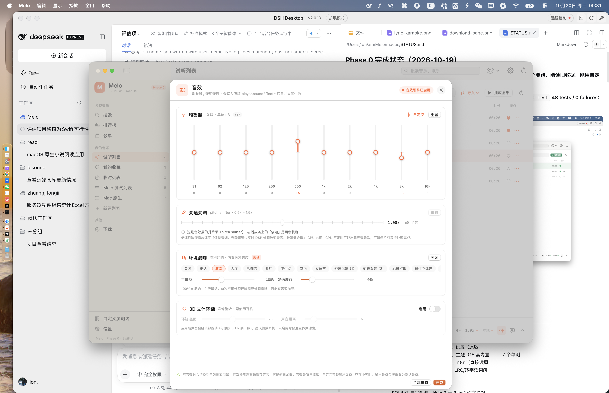 |

| 备份与恢复 | 开放 API |
| --- | --- |
|  |  |

| 播放队列 | 播放模式 | 快捷键设置 |
| --- | --- | --- |
|  |  | 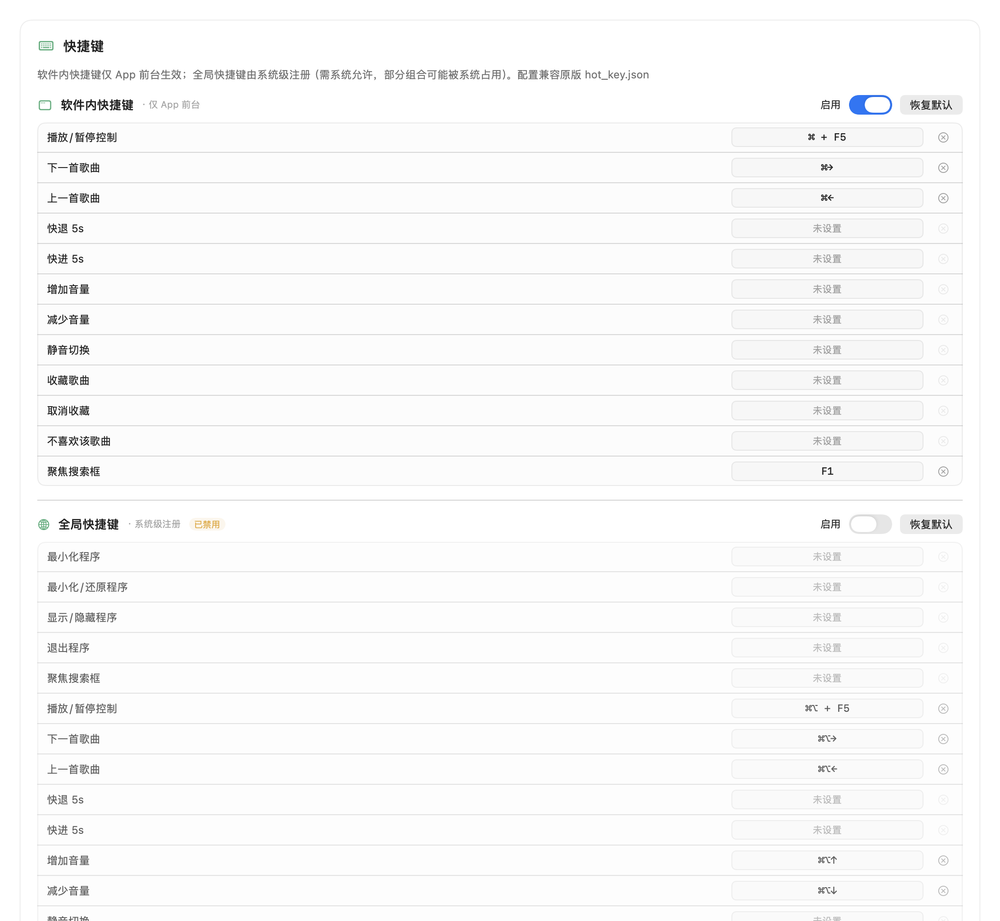 |

| 桌面歌词设置 | 歌曲评论 | 缓存管理 |
| --- | --- | --- |
| 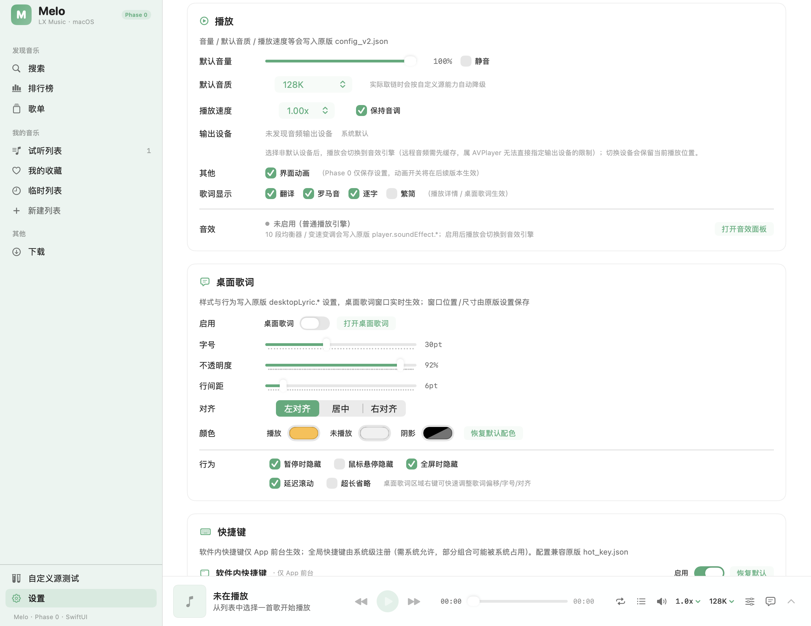 | 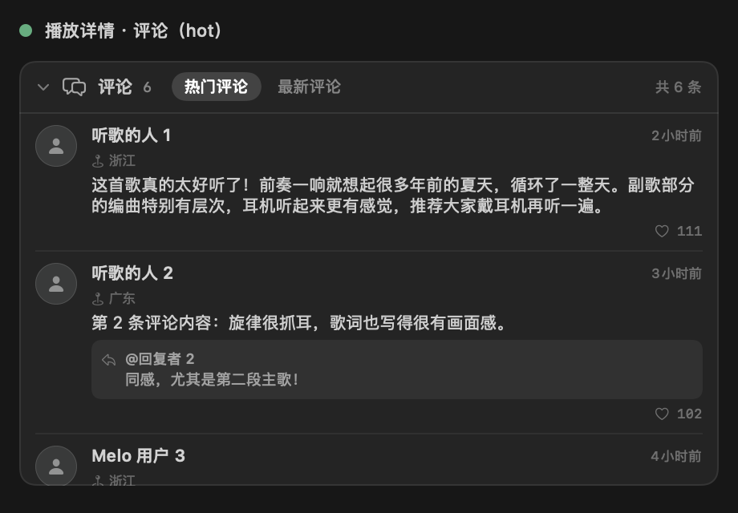 | 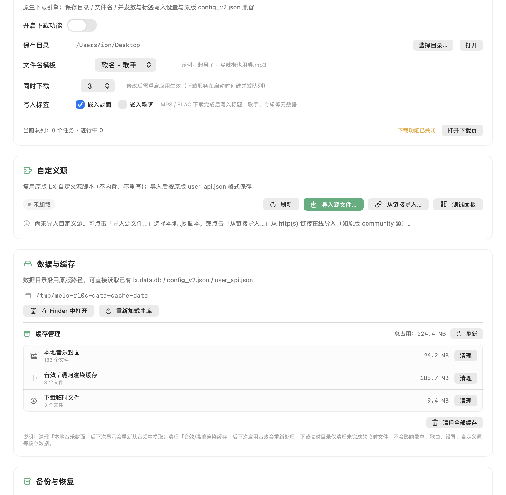 |

## 构建与运行

```bash
# 依赖：Xcode 27 / Swift 6.4+（无第三方依赖）
cd macos
swift build                       # 编译
swift test                        # 单元测试
Scripts/build-app.sh debug --run  # 组装 build/Melo.app 并启动
```

开发期也可直接运行：

```bash
MELO_RESOURCES="$PWD/Resources" swift run Melo
```

## 测试自定义源（本地联调，不内置）

```bash
# 终端 1：启动本地测试服务（生成测试音频/歌词，校验签名）
node Scripts/demo-server.mjs --port 27331

# 然后在 Melo 中导入并激活 TestAssets/demo-source.js：
#   设置 → 自定义源 → 导入源文件 → 选中 TestAssets/demo-source.js
#   进入「自定义源测试」页面，粘贴 TestAssets/sample-music-info.json 里的任意一条，
#   点击「解析并播放」。
```

真实的落雪自定义源可直接用 `.js` 文件导入测试（测试用源不会被打包进 App）。

## 数据兼容说明

- 直接打开原版 `LxDatas/lx.data.db`（原版 DDL + WAL），不迁移、不重建。
- 设置写回 `config_v2.json` 的 `{ "setting": {...} }` 结构；自定义源写回 `user_api.json` 的 `gz_` 格式。
- 开发/测试时请不要同时运行原版 LX Music（单写者）。

## 许可

本项目是非官方移植，遵循原项目 Apache-2.0 许可；不得用于商业用途。原始项目版权归 lyswhut 所有。


## 结项状态

目标范围内的移植工作已完成，验证与限制见 [docs/PORT-COMPLETION.md](docs/PORT-COMPLETION.md)：
- 292 项测试全过、`swift build` 零警告零错误
- 真实自定义源导入→取链→播放→下载 E2E 通过；五平台在线搜索/榜单/歌单/歌词通过
- 未完成：数据同步（后置）、签名公证/自动更新（需开发者账号）、i18n 自定义长文案翻译
